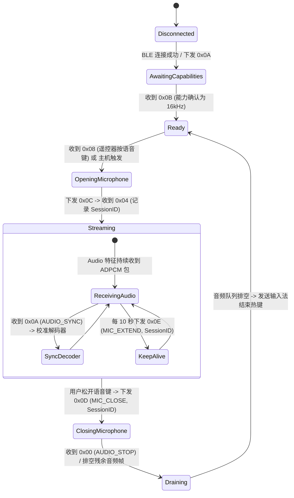

# 遥控器与 ATVV 协议规范 (Device Protocols)

本文档整理了 Windows 平台支持的蓝牙电视遥控器规格、完整 ATVV（Android TV Voice）协议细节、音频编解码同步机制以及 HID 按键报文映射。

---

## 一、支持的硬件设备范围与验证边界

> [!IMPORTANT]
> 下表中凡标注“已验证”者，均指已在 **macOS 平台** 完成了协议解析与实机测试；**Windows 平台由于蓝牙协议栈（WinRT）与 HID 驱动存在差异，所有设备均需在 Phase 1 阶段重新进行 Windows 真机验收。**

| 硬件型号 | 识别特征 (VID/PID / 名称) | 语音协议 | 普通按键支持 | 状态与验证边界 |
| :--- | :--- | :--- | :--- | :--- |
| **小米蓝牙遥控器 2** (RC001) | 广播名包含 `XiaoMi` 或 `RC001` | ATVV v1.0 (16kHz) | 支持（完整方向、确认、主页、返回、音量） | **macOS 已验证**；默认高半字节优先 (High Nibble First)。Windows 待真机验收。 |
| **小米蓝牙遥控器 2 Pro** (RC003) | 广播名包含 `RC003` | ATVV v1.0 (16kHz) | 支持 | **macOS 已验证**；高半字节优先。Windows 待真机验收。 |
| **Google Chromecast 遥控器** (G9N9N) | VID: `0x18D1`, PID: `0x9450`；名称 `Chromecast Remote` | ATVV v1.0 (16kHz) | 仅部分支持（见后文按键屏蔽说明） | **macOS 语音已验证**；单键在部分系统会被丢弃。Windows 待真机验收。 |
| **Google TV Streamer 遥控器** (GY3LE) | Google 2024 款新品 | ATVV 兼容 | 计划支持 | 待后续硬件适配。 |

---

## 二、完整 ATVV 控制协议与报文布局

ATVV 是 Google Android TV 生态的低功耗蓝牙语音标准，小米与 Chromecast 遥控器均遵循其状态机与控制报文。

### 1. GATT 服务与特征值
所有控制与音频流均挂载于主服务 `AB5E0001`：
* **主服务 (Service)**：`AB5E0001-5A21-4F05-BC7D-AF01F617B664`
* **主机写入特征 (Transmit)**：`AB5E0002-5A21-4F05-BC7D-AF01F617B664` (Write / Write Without Response)
* **音频流上报特征 (Audio)**：`AB5E0003-5A21-4F05-BC7D-AF01F617B664` (Notify)
* **控制状态特征 (Control)**：`AB5E0004-5A21-4F05-BC7D-AF01F617B664` (Notify / Indicate)

---

### 2. 关键控制 Opcode 与完整报文结构

在以往实现中，如果仅简单收发开麦/关麦，极易导致遥控器卡死或音频不同步。必须严格实现以下双向控制报文：

| Opcode | 报文名称 | 方向 | 数据结构与字段定义 | 说明与处理逻辑 |
| :--- | :--- | :--- | :--- | :--- |
| `0x0A` | **GET_CAPABILITIES** | 主机 -> 遥控器 | `[0x0A, 0x01, 0x00, 0x00, 0x03, 0x03]` (v1.0) | 主机请求遥控器上报所支持的语音能力。 |
| `0x0B` | **CAPABILITIES_RESP** | 遥控器 -> 主机 | `bytes[0]=0x0B, bytes[1..2]=Version, bytes[3]=Codecs, bytes[4]=Interaction, bytes[5..6]=FrameSize` | 协商能力：校验采样率必须为 16kHz (`Codec=0x02`)，提取每帧大小。 |
| `0x08` | **START_SEARCH** | 遥控器 -> 主机 | `[0x08]` | **语音键按下通知**：多数遥控器按下语音键时不发送普通 HID 键值，而是直接在 Control 特征值上报 `0x08`，触发主机开麦流程。 |
| `0x0C` | **MIC_OPEN** | 主机 -> 遥控器 | `[0x0C, 0x00]` (v1.0+) | 主机响应 `0x08`，同意遥控器开始采集并上报音频。 |
| `0x0C` | **MIC_REFUSED** | 遥控器 -> 主机 | `[0x0C]` | 遥控器拒绝开麦（如电量过低或正在进行 OTA）。 |
| `0x04` | **AUDIO_START** | 遥控器 -> 主机 | `bytes[0]=0x04, bytes[1]=Interaction, bytes[2]=Codec, bytes[3]=SessionID` | **音频流开始确认**：遥控器正式启动推流。**必须动态捕获 `bytes[3]` 的 SessionID**，后续关麦与保活必须携带此动态 ID！ |
| `0x0A` | **AUDIO_SYNC** | 遥控器 -> 主机 | `bytes[0]=0x0A, bytes[1..3]=Reserved, bytes[4..5]=Predictor(大端 Int16), bytes[6]=StepIndex` | **关键同步报文**：由于 BLE 丢包或重连，遥控器在流中定期发送 ADPCM 状态，**主机解码器必须立即用此值重置 Predictor 与 StepIndex**，否则解码将产生严重白噪声或啸叫。 |
| `0x0D` | **MIC_CLOSE** | 主机 -> 遥控器 | `[0x0D, SessionID]` (v1.0+) | 主机请求关闭麦克风。**必须带上 `AUDIO_START` 返回的动态 SessionID**。 |
| `0x00` | **AUDIO_STOP** | 遥控器 -> 主机 | `[0x00]` | **遥控器停止确认**：遥控器确认停止音频发送。主机接收到此报文后排空残留帧。 |
| `0x0E` | **MIC_EXTEND** | 主机 -> 遥控器 | `[0x0E, SessionID]` | **长按保活命令**：按住说话超过 10 秒时，主机必须每隔数秒下发一次保活，否则部分固件会自动超时挂断音频流。 |

---

### 3. 会话状态机转换图



---

## 三、IMA ADPCM 解码算法与状态同步实现

遥控器采集的 16kHz 音频被压缩为 4-bit IMA ADPCM（压缩比 4:1）。

### 1. 算法常数表
```csharp
public static class ImaAdpcmTables
{
    public static readonly int[] StepTable = new int[]
    {
        7, 8, 9, 10, 11, 12, 13, 14, 16, 17, 19, 21, 23, 25, 28, 31,
        34, 37, 41, 45, 50, 55, 60, 66, 73, 80, 88, 97, 107, 118, 130,
        143, 157, 173, 190, 209, 230, 253, 279, 307, 337, 371, 408, 449,
        494, 544, 598, 658, 724, 796, 876, 963, 1060, 1166, 1282, 1411,
        1552, 1707, 1878, 2066, 2272, 2499, 2749, 3024, 3327, 3660, 4026,
        4428, 4871, 5358, 5894, 6484, 7132, 7845, 8630, 9493, 10442,
        11487, 12635, 13899, 15289, 16818, 18500, 20350, 22385, 24623,
        27086, 29794, 32767
    };

    public static readonly int[] IndexTable = new int[]
    {
        -1, -1, -1, -1, 2, 4, 6, 8
    };
}
```

### 2. 状态同步与解码器实现 (C#)
```csharp
public sealed class ImaAdpcmDecoder
{
    private int _predictor;
    private int _stepIndex;

    public bool LowNibbleFirst { get; set; } = false; // 小米默认 false (高位优先)

    /// <summary>
    /// 响应 ATVV 0x0A (AUDIO_SYNC) 报文，无缝校准解码器内部状态
    /// </summary>
    public void Synchronize(short syncPredictor, byte syncStepIndex)
    {
        _predictor = syncPredictor;
        _stepIndex = Math.Clamp((int)syncStepIndex, 0, 88);
    }

    public void Reset()
    {
        _predictor = 0;
        _stepIndex = 0;
    }

    public void Decode(ReadOnlySpan<byte> input, Span<short> output)
    {
        int outIdx = 0;
        for (int i = 0; i < input.Length; i++)
        {
            byte b = input[i];
            byte nibble1 = (byte)(LowNibbleFirst ? (b & 0x0F) : ((b >> 4) & 0x0F));
            byte nibble2 = (byte)(LowNibbleFirst ? ((b >> 4) & 0x0F) : (b & 0x0F));

            output[outIdx++] = DecodeSample(nibble1);
            output[outIdx++] = DecodeSample(nibble2);
        }
    }

    private short DecodeSample(byte nibble)
    {
        int step = ImaAdpcmTables.StepTable[_stepIndex];
        int diff = step >> 3;

        if ((nibble & 4) != 0) diff += step;
        if ((nibble & 2) != 0) diff += step >> 1;
        if ((nibble & 1) != 0) diff += step >> 2;

        if ((nibble & 8) != 0)
            _predictor -= diff;
        else
            _predictor += diff;

        _predictor = Math.Clamp(_predictor, -32768, 32767);
        _stepIndex = Math.Clamp(_stepIndex + ImaAdpcmTables.IndexTable[nibble & 7], 0, 88);

        return (short)_predictor;
    }
}
```

---

## 四、HID 按键报文映射与限制说明

### 1. Google Chromecast 遥控器 (G9N9N)
G9N9N 遥控器通过 Consumer Control 页面（`0x0C`）上报普通按键：
* **Usage 码表**：
  * 方向上/下/左/右：`0x0042`, `0x0043`, `0x0044`, `0x0045`
  * 确认 (OK)：`0x0041`
  * 返回 (Back)：`0x0224`；主页 (Home)：`0x0223`
  * 静音 / 音量+ / 音量-：`0x00E2`, `0x00E9`, `0x00EA`
* **特别注意**：语音按键通常不依赖上述普通 HID 按键流，而是完全由 ATVV 的 `0x08` 控制消息驱动。对于普通按键的拦截与屏蔽，受限于 Windows 机制，具体处理方案详见 [按键监听与快捷键注入规范](input-and-hotkeys.md)。
