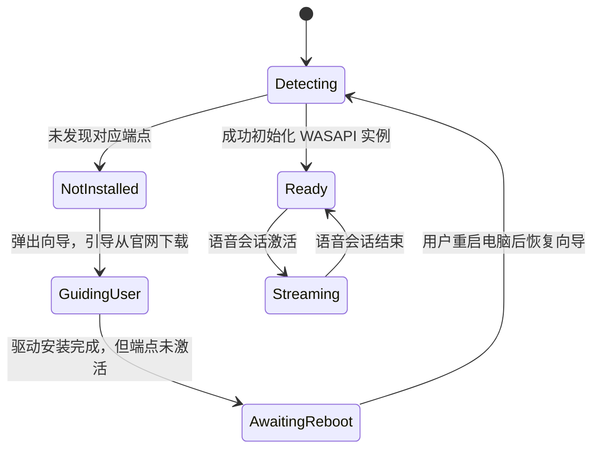

# 虚拟音频与驱动集成方案 (Virtual Audio & Driver)

本文档阐述 Windows 平台下虚拟音频驱动的合规决策、VB-CABLE 的集成模式、安装状态流转以及基于 WASAPI 的低延迟推流实现。

---

## 一、Windows 驱动约束与分发许可决策

### 1. Windows 内核驱动强制签名 (DSE)
在 64 位 Windows 10/11 操作系统中，系统音频端点必须由底层驱动（基于 WDM / SysVAD 规范的 `.sys` 文件）创建。
* **微软 DSE 机制**：Windows 内核强制要求音频驱动必须具有微软官方硬件认证（WHQL 签名）；
* **自签名完全无效**：未经微软签名的内核驱动直接报错 Code 52 拒绝加载；开启“测试模式（Test Mode）”会产生桌面水印并破坏反作弊游戏环境，无法面向普通用户。

### 2. 第三方驱动许可与分发策略
目前 Windows 平台上广泛普及且拥有合法微软 WHQL 认证的虚拟音频驱动是 **[VB-CABLE](https://vb-audio.com/Cable/)**（由 VB-Audio Software 出品）。

> [!IMPORTANT]
> **开源许可与分发合规边界**：
> 1. 本项目采用 GPL-3.0-only 许可证。根据项目规范，分发的公共二进制包必须随附完整源码。VB-CABLE 为闭源商业/Donationware 软件，[其分发条款](https://vb-audio.com/Services/licensing.htm) 要求商业分发必须获得专门授权，不能将其视作可随意打包集成的开源依赖；
> 2. **初期交付决策**：**本项目安装包内严禁私自捆绑或内置 VB-CABLE 安装器**；
> 3. **引导方案**：在应用设置向导的第一步，若检测到缺少虚拟麦克风，界面展示官方来源声明、Donationware 属性提示，并提供官方下载链接，引导用户自行下载安装。

---

## 二、驱动状态检测与生命周期管理

VB-CABLE 的官方参考手册明确指出：**驱动安装或更新后，需要重启系统以完成 Windows 音频服务的端点注册**。不能简单假设“等待 1~2 秒即可直接就绪”。

### 1. 状态流转机设计



### 2. 真实可用性验证（非单纯匹配设备名称）
仅仅检查设备管理器或注册表中的名字字符串并不能证明端点真正可用（可能处于“挂起等待重启”状态）。必须通过 **实际调用 WASAPI 初始化接口** 进行验证：

```csharp
using NAudio.CoreAudioApi;
using NAudio.Wave;

public enum DriverReadinessStatus
{
    Ready,
    NotInstalled,
    RebootRequired,
    InitializationFailed
}

public static class VirtualAudioAuditor
{
    public static DriverReadinessStatus AuditCableInputDevice()
    {
        using var enumerator = new MMDeviceEnumerator();
        var renderDevices = enumerator.EnumerateAudioEndPoints(DataFlow.Render, DeviceState.Active);
        
        var cableInput = renderDevices.FirstOrDefault(d => 
            d.FriendlyName.Contains("CABLE Input", StringComparison.OrdinalIgnoreCase));

        if (cableInput == null)
        {
            // 进一步检查是否存在 Disabled 或 NotPresent 状态，判断是否正在等待重启
            var allDevices = enumerator.EnumerateAudioEndPoints(DataFlow.Render, DeviceState.All);
            bool pending = allDevices.Any(d => d.FriendlyName.Contains("CABLE Input", StringComparison.OrdinalIgnoreCase));
            return pending ? DriverReadinessStatus.RebootRequired : DriverReadinessStatus.NotInstalled;
        }

        // 核心：尝试以 16kHz 16-bit 单声道真实打开音频客户端，确保音频栈真正就绪
        try
        {
            var waveFormat = new WaveFormat(16000, 16, 1);
            using var testOut = new WasapiOut(cableInput, AudioClientShareMode.Shared, useEventSync: true, latency: 20);
            var dummyProvider = new BufferedWaveProvider(waveFormat);
            testOut.Init(dummyProvider);
            return DriverReadinessStatus.Ready;
        }
        catch (Exception ex)
        {
            // 若抛出 AUDCLNT_E_DEVICE_INVALIDATED 或特定 HRESULT，说明驱动需要重启
            return DriverReadinessStatus.RebootRequired;
        }
    }
}
```

---

## 三、WASAPI 低延迟推流引擎实现

当遥控器麦克风激活时，解码出的 PCM 数据流必须连续、平滑、低延迟地泵入虚拟声卡。

### 1. 音频格式规格
* **采样率**：`16,000 Hz` (16kHz)
* **声道数**：`1` (Mono 单声道)
* **采样位深**：`16-bit Signed Integer (short)`
* **波形格式**：标准 PCM (`WaveFormat(16000, 16, 1)`)

### 2. 环形缓冲队列 (Jitter Buffer) 与首尾音防护
* **Pre-roll 预加载（首音保护）**：会话刚建立时，缓冲前 20~40ms 的数据后再启动推流，防止输入法冷启动阶段吞掉第一个字；
* **Drain 尾音排空（尾音保护）**：按键释放后，音频推流引擎继续工作，直到 BLE 尾包全部解码并完整写入 WASAPI 缓冲区后，才向输入法发送停止信号。

### 3. C# NAudio WASAPI 推流核心逻辑
```csharp
using NAudio.Wave;
using NAudio.CoreAudioApi;

public sealed class VirtualAudioStreamer : IDisposable
{
    private WasapiOut? _wasapiOut;
    private BufferedWaveProvider? _waveProvider;
    private readonly WaveFormat _format = new WaveFormat(16000, 16, 1);

    public void Initialize(MMDevice cableInputDevice)
    {
        _wasapiOut = new WasapiOut(cableInputDevice, AudioClientShareMode.Shared, useEventSync: true, latency: 20);
        
        _waveProvider = new BufferedWaveProvider(_format)
        {
            BufferDuration = TimeSpan.FromMilliseconds(500),
            DiscardOnBufferOverflow = true
        };

        _wasapiOut.Init(_waveProvider);
        _wasapiOut.Play();
    }

    public void WritePcmData(ReadOnlySpan<short> samples)
    {
        if (_waveProvider == null) return;
        
        // 转换 short span 为字节写入
        byte[] bytes = new byte[samples.Length * 2];
        Buffer.BlockCopy(samples.ToArray(), 0, bytes, 0, bytes.Length);
        _waveProvider.AddSamples(bytes, 0, bytes.Length);
    }

    public void DrainAndStop()
    {
        // 等待缓冲区残余数据播放完毕 (约 30~50ms)
        Thread.Sleep(50);
        _wasapiOut?.Stop();
    }

    public void Dispose()
    {
        _wasapiOut?.Stop();
        _wasapiOut?.Dispose();
        _wasapiOut = null;
    }
}
```
